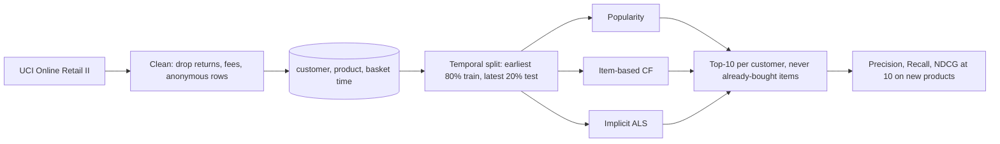

# E-Commerce Recommender: collaborative filtering and matrix factorisation on public retail data

[](https://creativecommons.org/licenses/by-nc-nd/4.0/)


## Overview

This repository compares three recommendation approaches for an online store: a popularity baseline, item-based collaborative filtering and implicit-feedback matrix factorisation (ALS). It is an **independent re-implementation on public data** (UCI Online Retail II), written to show the approaches end to end with tests, a temporal evaluation protocol and a small interactive demo. It is not the original deployed system, and it contains no client data or client code.

## Demo

A static page, `docs/index.html`, lets you pick a sample customer or search for a few products and compare the top-10 recommendations of all three models, each with a "because you bought..." explanation. It runs entirely in the browser from precomputed data and needs no server.


Open `docs/index.html` in a browser, or serve it locally with `python -m http.server 8000 --directory docs` and visit http://localhost:8000. It is not deployed anywhere. The page deliberately shows no accuracy numbers; see Results below.

## Problem statement

Given a customer's purchase history, rank the products they are most likely to buy next. In a wholesale-heavy gift shop with about 4,600 products and sparse histories, a recommender should do better than "show the best sellers to everyone", without needing product text or images.

## Approach



| Model | How it works |
|---|---|
| Popularity baseline | Ranks products by the number of distinct customers who bought them in the training period. The same list for everyone, minus what the customer already owns. |
| Item-based CF | Cosine similarity between product purchase vectors (which customers bought which product). A customer's score for a product is the sum of its similarities to the products they bought. The explanation is the purchased product with the highest similarity to the recommendation. |
| Implicit ALS | Matrix factorisation for implicit feedback (Hu, Koren and Volinsky, 2008), implemented in NumPy. Preference is 1 for every purchase; confidence is `1 + alpha * log1p(baskets containing the product)`. 32 factors, 15 alternating iterations, regularisation 0.1, alpha 10, fixed in advance and not tuned. The explanation is the purchased product whose factor vector is most cosine-similar to the recommendation. |

Choices that matter for the numbers:

- **Temporal split, fixed seed.** Train is every purchase record strictly before 2011-09-12 12:27; test is everything from then on. Baskets are never split across the cut. The seed (42) controls only the ALS initialisation; everything else is deterministic.
- **Evaluation customers.** Customers seen in training who bought at least one product in the test period that they had not bought in training. Recommendations exclude everything bought in training, and the ground truth is the new products only. Customers who first appear in the test period (cold start) are not evaluated.
- **Metrics.** Precision@10, Recall@10 and NDCG@10 with binary relevance, averaged over evaluation customers.

## Data

- **Source:** [UCI Online Retail II](https://archive.ics.uci.edu/dataset/502/online+retail+ii), transactions of a UK-based online gift retailer between 2009-12-01 and 2011-12-09 (1,067,371 raw rows). Licensed CC BY 4.0. Creator: Daqing Chen.
- **After cleaning:** 766,079 (customer, product, basket) records, 5,852 customers, 4,619 products. Removed: cancellations and returns, non-product codes (postage, fees, adjustments), rows without a customer id, non-positive quantity or price.
- **Split:** 612,817 train records (5,267 customers, 4,452 products), 153,262 test records, 2,191 evaluation customers.
- **Download:** `scripts/download_data.py` fetches the file and checks recorded SHA-256 checksums (zip `572e3627...e67bfb`, workbook `bcbe73b3...e2df2e980`). The raw data is never committed.
- **Privacy:** the dataset uses pseudonymous customer numbers. The demo shows only anonymous labels ("Sample customer 3"), product codes and product descriptions.

## Results

Independent re-implementation on public data. The 15% engagement and 10% revenue figures on the CV are reported results from an earlier deployment and are not reproduced here. The metrics below are offline ranking metrics on historical purchases; they are not business impact and say nothing about engagement or revenue.

| Metric | Popularity baseline | Item-based CF | Implicit ALS | Status | How measured | Date |
|---|---|---|---|---|---|---|
| Precision@10 | 0.0407 | 0.0599 (+47%) | 0.0628 (+54%) | Verified (run 2026-10-14) | temporal split, 2,191 customers, seed 42, new products only | 2026-10-14 |
| Recall@10 | 0.0167 | 0.0307 (+84%) | 0.0329 (+97%) | Verified (run 2026-10-14) | same | 2026-10-14 |
| NDCG@10 | 0.0434 | 0.0682 (+57%) | 0.0713 (+64%) | Verified (run 2026-10-14) | same | 2026-10-14 |

Percentages are relative to the popularity baseline. The run log, with the environment, data statistics and timings, is in [`docs/runs/2026-10-14-evaluation.md`](docs/runs/2026-10-14-evaluation.md) (machine-readable copy: `.json`). The test-first record is in [`docs/runs/2026-10-14-tests-red.md`](docs/runs/2026-10-14-tests-red.md) and [`docs/runs/2026-10-14-tests-green.md`](docs/runs/2026-10-14-tests-green.md).

Absolute values are low because the task is hard (predicting new products among about 4,500, many customers buy repeat items) and the test period contains the pre-Christmas peak. This is a single split and a single seed with no confidence intervals, so the ALS and item-based CF results should be read as close to each other and clearly above the baseline, not as a ranking of the two.

## Tech stack

Python 3.11, NumPy, pandas, SciPy, openpyxl (dataset reader), pytest. Plain HTML, CSS and JavaScript for the demo. CPU only; the full pipeline runs in about two minutes.

## Getting started

Prerequisites: Python 3.11 and about 300 MB of free disk space for the data.

```bash
git clone https://github.com/Janeferdinant/ecommerce-recommender.git
cd ecommerce-recommender
python -m venv .venv
source .venv/bin/activate            # Windows PowerShell: .venv\Scripts\Activate.ps1
pip install -r requirements.txt
python -m pytest -q                  # expected: 29 passed
python scripts/download_data.py      # expected last line: OK: data verified (UCI Online Retail II, CC BY 4.0)
python scripts/run_evaluation.py --seed 42
python scripts/build_demo_data.py --seed 42   # regenerates docs/demo-data.json and docs/demo-data.js
```

`run_evaluation.py` reads and cleans the workbook on the first run (about one minute, then cached under `data/cache/`), fits the three models (about 20 seconds) and writes `docs/runs/<today>-evaluation.md` and `.json`. The table printed at the end should match the Results section.

## Project structure

```
src/ecomrec/        split.py, metrics.py, models.py, evaluate.py, data.py
tests/              split leakage, metric toy cases, determinism, no already-bought items, cleaning
scripts/            download_data.py, run_evaluation.py, build_demo_data.py
docs/index.html     interactive demo (plus demo-data.json / demo-data.js and screenshots)
docs/runs/          dated run logs: tests (red, green), evaluation, demo check
THIRD_PARTY_NOTICES.md   dataset and library licenses
```

## Real-world applications

The same pipeline shape applies to "customers also bought" shelves on product pages, basket cross-sell, post-purchase emails and re-ordering prompts for wholesale accounts. A popularity baseline is a sensible fallback for new customers; the collaborative models take over once a customer has a purchase history.

## Limitations

- **Offline metrics only.** Precision, Recall and NDCG on historical purchases do not measure engagement, conversion or revenue. There is no online A/B test, so no claim about business impact is made.
- **Cold start.** New customers and new products are not handled by the collaborative models. Customers absent from training are excluded from evaluation, and the models fall back to popularity for them.
- **One split, one seed.** No confidence intervals; ALS hyperparameters were fixed in advance and not tuned.
- **Seasonality.** The test window covers the autumn peak, so the baseline and the models are all evaluated in a busy period.
- **Wholesale customers.** Many accounts are wholesalers with large, repetitive baskets, which differs from a typical consumer store.
- **Demo approximation.** The "Pick products" mode uses the 800 most popular products and each product's 40 nearest neighbours; the sample-customer mode uses the full models.

## Future scope

Time-decayed and repeat-purchase-aware scoring; tuning ALS on a validation window; ranking-loss models such as BPR; content features (product text) for cold start; coverage, diversity and novelty metrics; confidence intervals across several time windows; an online A/B test design with engagement and revenue as the outcomes.

## Credits & citation

- Dataset: Chen, D. (2012). *Online Retail II* [Dataset]. UCI Machine Learning Repository. https://doi.org/10.24432/C5CG6D (CC BY 4.0).
- Hu, Y., Koren, Y., Volinsky, C. (2008). Collaborative filtering for implicit feedback datasets. *IEEE ICDM*.
- Sarwar, B., Karypis, G., Konstan, J., Riedl, J. (2001). Item-based collaborative filtering recommendation algorithms. *WWW*.

To cite this repository: Ferdinant, J. R. (2026). *E-Commerce Recommender: an independent re-implementation on public data* [Software]. https://github.com/Janeferdinant/ecommerce-recommender

## License

Original work © Jane Rose Ferdinant, licensed CC BY-NC-ND 4.0. Third-party components retain their own licenses; see THIRD_PARTY_NOTICES.md.

## Author

Jane Rose Ferdinant, Assistant Professor, AI and ML.

- Portfolio: https://janeferdinant.vercel.app
- LinkedIn: https://www.linkedin.com/in/janerosenf/
