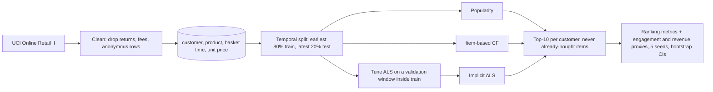

# E-Commerce Recommendation: recommendation approaches for an online store

[](https://creativecommons.org/licenses/by-nc-nd/4.0/)

[](https://janeferdinant.github.io/ecommerce-recommender/)

## Overview

Recommendation approaches for an online store, with reported gains in user engagement and sales revenue. The reported gains (15% higher user engagement and a 10% improvement in sales revenue, as stated on the CV) come from an earlier deployment. They are labelled **Reported (earlier deployment)**: they are not reproduced, confirmed or contradicted by this repository, which has no access to that system, its data or its code.

This repository is an **independent re-implementation on public data** (UCI Online Retail II). It compares three recommendation approaches (popularity baseline, item-based collaborative filtering, implicit-feedback matrix factorisation) with tests, a temporal evaluation protocol and a small interactive demo. For each approach it reports *offline proxies* for engagement and revenue, computed on historical purchases. These proxies show the direction in which the approaches differ; they are not the deployed engagement and revenue gains.

### Summary

Verified (run 2026-10-14), offline proxies on public data, 2,191 evaluation customers, top 10 recommendations, ALS averaged over 5 seeds. Not the deployed engagement and revenue gains.

| Offline measure | Popularity baseline | Item-based CF | Implicit ALS | ALS vs popularity (95% CI) |
|---|---|---|---|---|
| Hit rate@10: customers with at least one correct recommendation (engagement proxy) | 28.8% | 35.6% | 39.5% | +37% (+28% to +48%) |
| Revenue@10: unit-price-weighted value of correct recommendations, GBP per customer (revenue proxy) | 1.49 | 1.46 | 1.70 | +15% (+3.5% to +27.5%) |
| NDCG@10 (ranking quality) | 0.0434 | 0.0682 | 0.0726 | +67% (+52% to +83%) |

Catalogue coverage and the other ranking metrics are in the detailed Results table below.

Item-based CF is clearly better than popularity on hit rate (+24%, interval +16% to +32%) but its revenue proxy is not distinguishable from the baseline (-1.7%, interval -10.9% to +7.8%).

Observation, not a tested cause: item-based CF recommends far more of the catalogue than popularity does (coverage 17.7% against 1.8%), which is consistent with it favouring niche items over best sellers, and in this run that did not raise the revenue proxy.

| Reported on the CV | Status |
|---|---|
| 15% higher user engagement | Reported (earlier deployment). Not reproduced here. |
| 10% improvement in sales revenue | Reported (earlier deployment). Not reproduced here. |

## Demo

[Open the live demo](https://janeferdinant.github.io/ecommerce-recommender/). Pick a sample customer or search for a few products and compare the top-10 recommendations of all three models, each with a "because you bought..." explanation. It runs entirely in the browser from precomputed data and needs no server. The page deliberately shows no metrics; see Results below.


To run it locally, open `docs/index.html` in a browser, or serve it with `python -m http.server 8000 --directory docs` and visit http://localhost:8000.

## Problem statement

Given a customer's purchase history, rank the products they are most likely to buy next. In a wholesale-heavy gift shop with about 4,600 products and sparse histories, a recommender should do better than "show the best sellers to everyone", without needing product text or images. In a real store the payoff is more engagement (customers who find something they want) and more revenue; this repository measures offline stand-ins for both.

## Approach



| Model | How it works |
|---|---|
| Popularity baseline | Ranks products by the number of distinct customers who bought them in the training period. The same list for everyone, minus what the customer already owns. |
| Item-based CF | Cosine similarity between product purchase vectors (which customers bought which product). A customer's score for a product is the sum of its similarities to the products they bought. The explanation is the purchased product with the highest similarity to the recommendation. |
| Implicit ALS | Matrix factorisation for implicit feedback (Hu, Koren and Volinsky, 2008), implemented in NumPy. Preference is 1 for every purchase; confidence is `1 + alpha * log1p(baskets containing the product)` with alpha 10. Factors (64), regularisation (1.0) and iterations (15) were selected on a validation window inside the training period; see `docs/runs/2026-10-14-als-tuning.md`. The explanation is the purchased product whose factor vector is most cosine-similar to the recommendation. |

Choices that matter for the numbers:

- **Temporal split.** Train is every purchase record strictly before 2011-09-12 12:27; test is everything from then on. Baskets are never split across the cut. Tuning never touches the test period: the training period is split again (earliest 80% fit, latest 20% validation).
- **Seeds.** The seed controls only the ALS initialisation. Results are the mean and sample standard deviation over seeds 42 to 46; popularity and item-based CF are deterministic.
- **Evaluation customers.** Customers seen in training who bought at least one product in the test period that they had not bought in training. Recommendations exclude everything bought in training, and the ground truth is the new products only. Customers who first appear in the test period (cold start) are not evaluated.
- **Ranking metrics.** Precision@10, Recall@10 and NDCG@10 with binary relevance.
- **Engagement proxies (offline).** Hit rate@10 is the share of evaluation customers with at least one correct recommendation. Coverage@10 is the share of the 4,452-product training catalogue that appears in anyone's top 10.
- **Revenue proxy (offline).** Revenue@10 is, per evaluation customer, the sum of the unit prices of the recommended products they actually bought in the test period, averaged over customers (GBP, as recorded in the data). Each product's price is its median unit price in the training period. It is not quantity-weighted and is not actual sales revenue; it is shown as a relative uplift over popularity.
- **Uncertainty.** Uplifts come with 95% paired bootstrap intervals over customers (1,000 resamples).

## Data

- **Source:** [UCI Online Retail II](https://archive.ics.uci.edu/dataset/502/online+retail+ii), transactions of a UK-based online gift retailer between 2009-12-01 and 2011-12-09 (1,067,371 raw rows). Licensed CC BY 4.0. Creator: Daqing Chen.
- **After cleaning:** 766,079 (customer, product, basket) records, 5,852 customers, 4,619 products. Removed: cancellations and returns, non-product codes (postage, fees, adjustments), rows without a customer id, non-positive quantity or price.
- **Split:** 612,817 train records (5,267 customers, 4,452 products), 153,262 test records, 2,191 evaluation customers.
- **Download:** `scripts/download_data.py` fetches the file and checks recorded SHA-256 checksums (zip `572e3627...e67bfb`, workbook `bcbe73b3...e2df2e980`). The raw data is never committed.
- **Privacy:** the dataset uses pseudonymous customer numbers. The demo shows only anonymous labels ("Sample customer 3"), product codes and product descriptions.

## Results

Independent re-implementation on public data. The 15% engagement and 10% revenue figures on the CV are Reported (earlier deployment) results and are not reproduced here. Everything below is an offline measurement on historical purchases (offline proxies, not the deployed engagement and revenue gains) and says nothing about live engagement or sales.

Mean ± sample sd over 5 seeds (42 to 46), k = 10, 2,191 evaluation customers.

| Metric | Popularity baseline | Item-based CF | Implicit ALS | Status | How measured | Date |
|---|---|---|---|---|---|---|
| Precision@10 | 0.0407 | 0.0599 | 0.0645 ± 0.0007 | Verified (run 2026-10-14) | temporal split, new products only | 2026-10-14 |
| Recall@10 | 0.0167 | 0.0307 | 0.0340 ± 0.0006 | Verified (run 2026-10-14) | same | 2026-10-14 |
| NDCG@10 | 0.0434 | 0.0682 | 0.0726 ± 0.0006 | Verified (run 2026-10-14) | same | 2026-10-14 |
| Hit rate@10 (engagement proxy) | 0.2880 | 0.3560 | 0.3953 ± 0.0032 | Verified (run 2026-10-14), offline proxy | share of customers with at least one correct recommendation | 2026-10-14 |
| Coverage@10 (engagement proxy) | 0.0180 | 0.1768 | 0.3066 ± 0.0020 | Verified (run 2026-10-14), offline proxy | distinct recommended products / 4,452 | 2026-10-14 |
| Revenue@10, GBP per customer (revenue proxy) | 1.4875 | 1.4625 | 1.7042 ± 0.0275 | Verified (run 2026-10-14), offline proxy | unit-price-weighted correct recommendations, training-period median prices | 2026-10-14 |

Popularity and item-based CF have no randomness, so their sd is zero.

Relative uplift over the popularity baseline, with 95% paired bootstrap intervals over customers:

| Metric | Item-based CF | Implicit ALS |
|---|---|---|
| Precision@10 | +47.4% (+36.5% to +59.7%) | +58.7% (+46.4% to +72.6%) |
| Recall@10 | +83.7% (+60.1% to +110.7%) | +103.2% (+73.7% to +136.7%) |
| NDCG@10 | +57.1% (+44.0% to +71.1%) | +67.1% (+52.0% to +83.1%) |
| Hit rate@10 (engagement proxy) | +23.6% (+16.2% to +32.1%) | +37.2% (+28.2% to +47.9%) |
| Revenue@10 (revenue proxy) | -1.7% (-10.9% to +7.8%) | +14.6% (+3.5% to +27.5%) |

How to read this: both collaborative models clearly beat popularity on ranking quality and hit rate, and ALS is ahead of item-based CF on every measure in point estimates (the gap between those two was not separately tested). Item-based CF does not improve the revenue proxy over the baseline in this run. Coverage is much higher for both models because popularity recommends nearly the same ten products to everyone; high coverage is not by itself better engagement. The bootstrap intervals reflect which customers fall in the test period and the seed sd reflects ALS initialisation; neither captures variation across time windows, because a single temporal split is used.

The run logs, with environment, data statistics and timings, are in `docs/runs/`:
[`2026-10-14-evaluation-multiseed.md`](docs/runs/2026-10-14-evaluation-multiseed.md) (current results, with `.json`),
[`2026-10-14-als-tuning.md`](docs/runs/2026-10-14-als-tuning.md) (validation-window tuning),
[`2026-10-14-evaluation.md`](docs/runs/2026-10-14-evaluation.md) (earlier single-seed run with untuned ALS, kept for the record),
and the test-first records (`tests-red*.md`, `tests-green.md`). Runtime on CPU: about 2.5 minutes to evaluate five seeds and about 3 minutes to tune ALS, well inside the 20-minute limit.

## Tech stack

Python 3.11, NumPy, pandas, SciPy, openpyxl (dataset reader), pytest, ruff. Plain HTML, CSS and JavaScript for the demo. CPU only.

## Getting started

Prerequisites: Python 3.11 and about 300 MB of free disk space for the data.

```bash
git clone https://github.com/Janeferdinant/ecommerce-recommender.git
cd ecommerce-recommender
python -m venv .venv
source .venv/bin/activate            # Windows PowerShell: .venv\Scripts\Activate.ps1
pip install -r requirements.txt -r requirements-dev.txt
python -m pytest -q                  # expected: 48 passed
python -m ruff check .               # expected: All checks passed!
python scripts/download_data.py      # expected last line: OK: data verified (UCI Online Retail II, CC BY 4.0)
python scripts/run_evaluation.py     # five seeds; about 4 minutes the first time (1 to 2 minutes to read the workbook)
python scripts/tune_als.py --seed 42 # optional: re-runs the ALS grid search, about 3 minutes
python scripts/build_demo_data.py --seed 42   # regenerates docs/demo-data.json and docs/demo-data.js
```

`run_evaluation.py` prints the tables in the Results section (it writes `docs/runs/<today>-evaluation-multiseed.md` and `.json`; the numbers should match those above). With `make` installed, `make install`, `make test`, `make lint`, `make download`, `make evaluate`, `make tune` and `make demo-data` run the same commands, and `make all` runs everything except `tune`.

## Project structure

```
src/ecomrec/        split.py, metrics.py, models.py, evaluate.py, tuning.py, stats.py, config.py, data.py
tests/              split leakage, metrics and proxies on toy cases, determinism, no already-bought items,
                    tuning window, bootstrap, cleaning
scripts/            download_data.py, run_evaluation.py, tune_als.py, build_demo_data.py
docs/index.html     interactive demo (plus demo-data.json / demo-data.js and screenshots)
docs/runs/          dated run logs: tests (red, green), tuning, evaluation, demo check, lint
Makefile            shortcuts for the commands above
THIRD_PARTY_NOTICES.md   dataset and library licenses
```

## Real-world applications

The same pipeline shape applies to "customers also bought" shelves on product pages, basket cross-sell, post-purchase emails and re-ordering prompts for wholesale accounts. A popularity baseline is a sensible fallback for new customers; the collaborative models take over once a customer has a purchase history.

## Limitations

- **Offline proxies only.** Hit rate, coverage and Revenue@10 are measured on historical purchases. They are not engagement or revenue in a live store, there is no online A/B test, and nothing here confirms or contradicts the 15% and 10% figures reported from the earlier deployment.
- **Revenue proxy is crude.** It uses unit prices (not quantities or margins), prices fixed at training-period medians, and only products the customer bought anyway; it cannot capture extra sales caused by a recommendation.
- **Cold start.** New customers and new products are not handled by the collaborative models. Customers absent from training are excluded from evaluation, and the models fall back to popularity for them.
- **One temporal split.** Seed variation and customer-sampling intervals are reported, but not variation across time windows. ALS tuning used a coarse grid, and the selected values sit at the edge of it for factors, regularisation and iterations.
- **Seasonality.** The test window covers the autumn peak, so all models are evaluated in a busy period.
- **Wholesale customers.** Many accounts are wholesalers with large, repetitive baskets, which differs from a typical consumer store.
- **Demo approximation.** The "Pick products" mode uses the 800 most popular products and each product's 40 nearest neighbours; the sample-customer mode uses the full models.

## Future scope

Time-decayed and repeat-purchase-aware scoring; evaluation over several rolling time windows; ranking-loss models such as BPR; content features (product text) for cold start; diversity and novelty metrics; a quantity- and margin-aware revenue estimate; an online A/B test design with engagement and revenue as the outcomes.

## Credits & citation

- Dataset: Chen, D. (2012). *Online Retail II* [Dataset]. UCI Machine Learning Repository. https://doi.org/10.24432/C5CG6D (CC BY 4.0).
- Hu, Y., Koren, Y., Volinsky, C. (2008). Collaborative filtering for implicit feedback datasets. *IEEE ICDM*.
- Sarwar, B., Karypis, G., Konstan, J., Riedl, J. (2001). Item-based collaborative filtering recommendation algorithms. *WWW*.

To cite this repository: Ferdinant, J. R. (2026). *E-Commerce Recommendation: an independent re-implementation on public data* [Software]. https://github.com/Janeferdinant/ecommerce-recommender

## License

Original work © Jane Rose Ferdinant, licensed CC BY-NC-ND 4.0. Third-party components retain their own licenses; see THIRD_PARTY_NOTICES.md.

## Author

Jane Rose Ferdinant, Assistant Professor, AI and ML.

- Portfolio: https://janeferdinant.vercel.app
- LinkedIn: https://www.linkedin.com/in/janerosenf/
