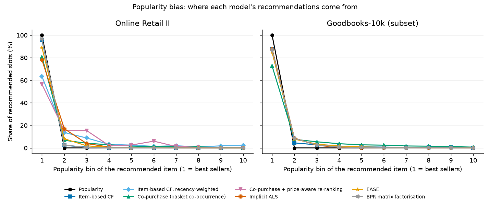
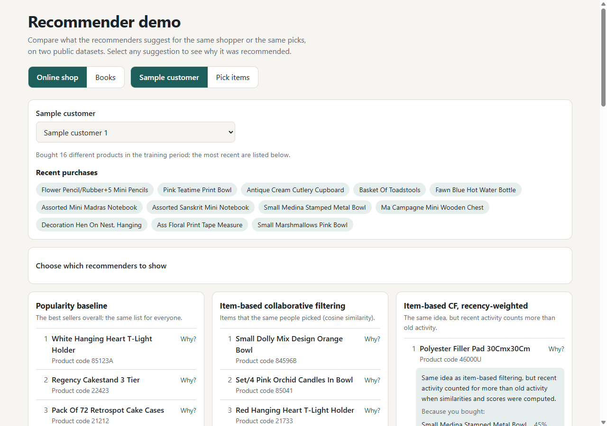
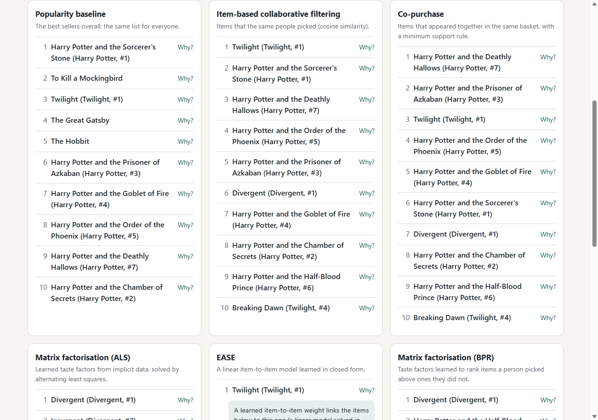
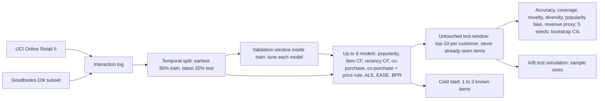
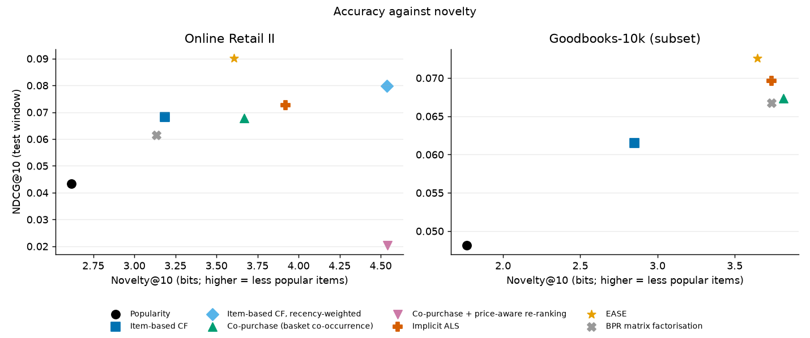
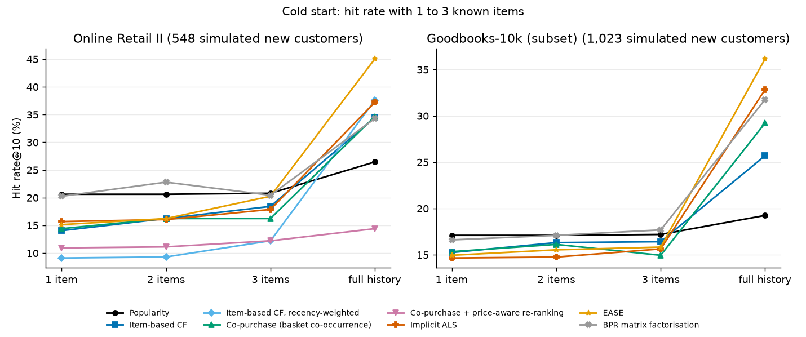
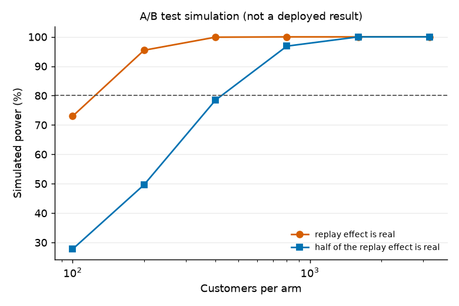

# E-Commerce Recommendation: a rigorous comparison of recommendation approaches on two public datasets

[](https://creativecommons.org/licenses/by-nc-nd/4.0/)

[](https://janeferdinant.github.io/ecommerce-recommender/)

## Overview

Recommendation approaches for an online store, with reported gains in user engagement and sales revenue. The reported gains (15% higher user engagement and a 10% improvement in sales revenue, as stated on the CV) come from an earlier deployment. They are labelled **Reported (earlier deployment)**: they are not reproduced, confirmed or contradicted by this repository, which has no access to that system, its data or its code.

This repository is an **independent re-implementation on public data**. It compares up to eight recommenders (popularity, item-based collaborative filtering, a recency-weighted variant, a co-purchase baseline with business rules, implicit-feedback ALS, EASE and BPR matrix factorisation) on two datasets, UCI Online Retail II and Goodbooks-10k (book ratings). Every model is tuned on a validation window inside the training period and reported once on an untouched test window, with bootstrap intervals over customers. Beyond accuracy it measures coverage, novelty, diversity, popularity bias, cold-start behaviour and an offline revenue proxy, and it includes a clearly labelled simulation of an A/B test. Everything reported is an offline measurement on historical data, not a business result.

### Summary

Verified (Online Retail II: run 2026-10-14; Goodbooks-10k: run 2026-10-15), offline measurements on public data, top 10 recommendations. The best model is the one with the highest validation NDCG@10 (chosen before the test window was used); intervals are 95% paired bootstrap intervals over customers.

| Dataset (protocol) | Best model | Hit rate@10 | NDCG@10 | Hit rate vs popularity | NDCG vs the runner-up on validation |
|---|---|---|---|---|---|
| Online Retail II (temporal split; 2,191 evaluation customers) | EASE | 46.1% | 0.0901 | +60.2% (+50.6% to +73.3%) | +12.8% (+5.6% to +20.5%) against recency-weighted item CF |
| Goodbooks-10k, 8,000-user subset (temporal split on file order; 4,092 evaluation customers) | EASE | 35.7% | 0.0726 | +90.1% (+78.4% to +103.2%) | +8.7% (+4.0% to +13.7%) against BPR |

- **The finding holds on both datasets.** EASE, a closed-form linear item-to-item model, is the most accurate model on both, ahead of the matrix-factorisation models (ALS, BPR) and of item-based CF. All personalised models beat popularity on accuracy with the full history.
- **Accuracy is not the whole picture.** Every model puts most recommendation slots on the best-selling tenth of the catalogue (EASE: 89% on Online Retail II, 85% on Goodbooks-10k). On Online Retail II the co-purchase model has the highest coverage (41%), and the price-aware and recency-weighted models the highest novelty; on Goodbooks-10k co-purchase has the highest coverage (37%) and novelty, behind EASE on accuracy.
- **Revenue proxy (Online Retail II).** EASE: 2.07 GBP per customer against 1.49 for popularity (+39.1%, +26.6% to +53.6%). A price-aware re-ranking rule raises the proxy to 2.15 (+44.8%) but cuts the hit rate by 53%: it trades accuracy for price.
- **Cold start is not solved.** With one to three known interactions, no personalised model is clearly better than popularity (intervals overlap); the models separate only with a longer history (see the cold-start section).
- **The A/B simulation is a design aid, not a result.** It shows the sample size a real experiment would need; see its section and caveats.

| Reported on the CV | Status |
|---|---|
| 15% higher user engagement | Reported (earlier deployment). Not reproduced here. |
| 10% improvement in sales revenue | Reported (earlier deployment). Not reproduced here. |



## Demo

[Open the live demo](https://janeferdinant.github.io/ecommerce-recommender/). Switch between the online shop and the books, pick a sample shop customer or a few items, and compare the top 10 of all models (six for books: the price rule needs prices and the recency model needs timestamps). Select any suggestion to open a "Why was this recommended?" panel that shows the items that drove it and, for the price-aware model, the price factor applied. It runs in the browser from precomputed data and needs no server. The page deliberately shows no metrics; see Results below.




To run it locally, open `docs/index.html` in a browser, or serve it with `python -m http.server 8000 --directory docs` and visit http://localhost:8000. The page's JavaScript is checked against a Python reference implementation (`src/ecomrec/demo_ref.py`): 56 of 56 comparisons identical, see `docs/runs/2026-10-15-demo-check-study.md`. The books page embeds an excerpt of CC BY-SA 4.0 data (600 titles and derived numbers) and credits its source in the footer; see Data and `THIRD_PARTY_NOTICES.md`.

## Problem statement

Given a customer's interaction history, rank the items they are most likely to want next, without using item text or images. In a wholesale-heavy gift shop with about 4,500 products and sparse histories, a recommender should do better than "show the best sellers to everyone"; the question is how much better, for which customers, and at what cost in diversity and in revenue. A second dataset (book ratings) checks whether the conclusions are specific to one shop.

## Approach



| Model | How it works |
|---|---|
| Popularity | The number of distinct customers who interacted with each item in the training period; the same list for everyone, minus what the customer already has. |
| Item-based CF | Cosine similarity between item interaction vectors; a customer's score for an item is the sum of its similarities to the items they interacted with. |
| Item-based CF, recency-weighted | The same, but each interaction is weighted by `0.5 ** (age / half-life)`, both when similarities are computed and when a customer's score is summed. Half-life tuned (grid 7 to 365 days or no decay). Needs real timestamps, so it is not run on Goodbooks-10k. |
| Co-purchase | "Customers who bought this also bought": basket-level co-occurrence counts (a basket is one customer at one time; for book ratings, one user), association `co / (n_j * n_i^beta)`, with a minimum-support rule. Beta and support tuned. |
| Co-purchase with price-aware re-ranking | The same scores multiplied by `(price / median price) ** gamma`, a business rule that favours dearer items. Gamma is chosen for validation Revenue@10, not for accuracy. Retail only (the book data has no prices). |
| Implicit ALS | Matrix factorisation for implicit feedback (Hu, Koren and Volinsky, 2008) in NumPy; confidence `1 + 10 * log1p(count)`. Factors, regularisation and iterations tuned. |
| EASE | Embarrassingly Shallow Autoencoder (Steck, 2019): the weight matrix minimising `||X - XB||^2 + reg * ||B||^2` with a zero diagonal, in closed form `B = -G^-1 / diag(G^-1)`. Regularisation tuned. |
| BPR | Bayesian Personalised Ranking (Rendle et al., 2009): matrix factorisation with item biases trained by mini-batch SGD with sampled negatives, in NumPy. Factors, learning rate and regularisation tuned. |

Choices that matter for the numbers:

- **Protocol (stated per dataset; temporal split on both).** *Online Retail II*: train is every purchase record strictly before 2011-09-12 12:27, test is everything from then on; baskets are never split. *Goodbooks-10k*: the ratings file has no timestamps; its documentation says the rows are sorted by time, so the position of a row in the (subsetted) file is used as the time and the earliest 80% of the ratings train while the latest 20% test. I cannot verify that order independently; it is the dataset author's statement. Evaluation customers are those seen in training who interacted with at least one item in the test period that they had not interacted with in training. Recommendations always exclude everything the customer interacted with in training. Every rating on Goodbooks-10k, whatever its value, counts as one implicit interaction.
- **Goodbooks-10k subset.** To keep every run within the CPU time limit, a seeded random sample (seed 0) of 8,000 of the 53,424 users is used with all their ratings, and books rated by fewer than 20 of those users are dropped (868,249 interactions, 8,361 books).
- **Tuning.** Only on a validation window inside the training period: the training period is split again with the same temporal rule (earliest 80% fit, latest 20% validation). The test window is never used for tuning. Selection rule: highest validation NDCG@10, earliest grid point on ties (price-aware co-purchase: validation Revenue@10). Tuned settings are in `configs/tuned-<dataset>.json`; the grids and the full tables are in `docs/runs/*-tuning-<dataset>*.md`.
- **Seeds.** Five seeds (42 to 46). Only ALS and BPR use randomness; the other models are deterministic and run once (sd shown only where it is non-zero).
- **Uncertainty.** Uplifts and model differences use paired bootstrap intervals over customers (1,000 resamples for uplifts, 2,000 for the best-two comparison). They reflect which customers are in the test window, not variation across time windows.
- **Best two models.** The two models with the highest *validation* NDCG@10 are compared on the test window, so the pair is not chosen by looking at test results.
- **Ranking metrics.** Hit rate@10, NDCG@10, Precision@10 and Recall@10 with binary relevance.

## Data

| | Online Retail II | Goodbooks-10k |
|---|---|---|
| Source | [UCI](https://archive.ics.uci.edu/dataset/502/online+retail+ii), UK gift retailer, 2009-12-01 to 2011-12-09 | [goodbooks-10k](https://github.com/zygmuntz/goodbooks-10k) by Zygmunt Zając: 5,976,479 ratings of 10,000 popular books by 53,424 users, collected from Goodreads |
| License | CC BY 4.0 (creator: Daqing Chen) | CC BY-SA 4.0 (the repository's `LICENSE`, evidence in `THIRD_PARTY_NOTICES.md`) |
| Used here | 766,079 (customer, product, basket) records; 5,852 customers; 4,619 products after cleaning (cancellations, non-product codes, rows without a customer id, non-positive quantity or price removed) | a seeded 8,000-user subset: 868,249 ratings, 8,361 books; every rating is an interaction |
| Split | temporal: 612,817 train, 153,262 test records; 2,191 evaluation customers; 4,452-product training catalogue | temporal on file order: 694,599 train, 173,650 test interactions; 4,092 evaluation customers; 8,085-book training catalogue |
| Download | `scripts/download_data.py`, SHA-256 checked (zip `572e3627...e67bfb`, workbook `bcbe73b3...e2df2e980`) | `scripts/download_data.py --dataset books`, SHA-256 checked (ratings.zip `2dd0ea8e...ebd2e`, books.zip `1e5e29f4...f7bd4f`) |

Raw data is never committed. The pseudonymous customer numbers of Online Retail II are never shown; the demo uses anonymous labels. **Licensing of the embedded excerpt:** `docs/demo-data-books.js` contains an excerpt of Goodbooks-10k (600 book titles and numbers the models computed from the ratings; no ratings, user ids or row order). That excerpt is licensed **CC BY-SA 4.0**, separately from the CC BY-NC-ND 4.0 that covers this repository's original code and text; credit Zygmunt Zając and Goodbooks-10k, link the licence, say that changes were made, and share adaptations under CC BY-SA 4.0. The full licence evidence is in `THIRD_PARTY_NOTICES.md`. The underlying content comes from Goodreads; I rely on the dataset author's licence statement and have not examined Goodreads' own terms.

## Results

Independent re-implementation on public data. The 15% engagement and 10% revenue figures on the CV are Reported (earlier deployment) results and are not reproduced here. Everything below is an offline measurement on historical data (Verified; Online Retail II run 2026-10-14, Goodbooks-10k run 2026-10-15; Python 3.11, CPU only) and says nothing about live engagement or sales.

### Accuracy (k = 10, test window, mean ± sd over 5 seeds where the model is seeded)

| Model | Retail hit rate | Retail NDCG | Books hit rate | Books NDCG |
|---|---|---|---|---|
| Popularity | 0.2880 | 0.0434 | 0.1879 | 0.0482 |
| Item-based CF | 0.3560 | 0.0682 | 0.2556 | 0.0615 |
| Item-based CF, recency-weighted | 0.3756 | 0.0799 | n/a (no timestamps) | n/a |
| Co-purchase | 0.3651 | 0.0679 | 0.2832 | 0.0674 |
| Co-purchase + price rule | 0.1356 | 0.0204 | n/a (no prices) | n/a |
| Implicit ALS | 0.3953 ± 0.0032 | 0.0726 ± 0.0006 | 0.3374 ± 0.0040 | 0.0696 ± 0.0006 |
| EASE | **0.4614** | **0.0901** | **0.3573** | **0.0726** |
| BPR | 0.3585 ± 0.0063 | 0.0614 ± 0.0029 | 0.3173 ± 0.0074 | 0.0667 ± 0.0014 |

Relative uplift over popularity, with 95% paired bootstrap intervals over customers (hit rate / NDCG):

| Model | Retail hit rate | Retail NDCG | Books hit rate | Books NDCG |
|---|---|---|---|---|
| Item-based CF | +23.6% (+16.2% to +32.1%) | +57.1% (+44.0% to +71.1%) | +36.0% (+28.6% to +44.2%) | +27.7% (+18.9% to +37.3%) |
| Item-based CF, recency-weighted | +30.4% (+21.8% to +42.1%) | +84.0% (+67.7% to +103.7%) | n/a | n/a |
| Co-purchase | +26.8% (+18.9% to +36.5%) | +56.2% (+43.0% to +70.5%) | +50.7% (+41.1% to +60.6%) | +39.8% (+28.5% to +52.5%) |
| Co-purchase + price rule | -52.9% (-58.1% to -47.6%) | -52.9% (-58.5% to -46.8%) | n/a | n/a |
| Implicit ALS | +37.2% (+28.2% to +47.9%) | +67.1% (+52.0% to +83.1%) | +79.6% (+68.0% to +92.5%) | +44.6% (+34.1% to +58.2%) |
| EASE | +60.2% (+50.6% to +73.3%) | +107.5% (+90.5% to +127.1%) | +90.1% (+78.4% to +103.2%) | +50.7% (+39.5% to +64.4%) |
| BPR | +24.5% (+18.4% to +31.9%) | +41.5% (+32.6% to +51.4%) | +68.8% (+58.7% to +80.2%) | +38.6% (+28.9% to +50.7%) |

### Comparing the best two models (paired bootstrap over customers)

The two best models on the validation window were EASE and recency-weighted item CF on Online Retail II, and EASE and BPR on Goodbooks-10k. On the test window EASE is ahead of the runner-up on every accuracy measure, and the intervals exclude zero:

| Dataset | Metric | EASE | Runner-up | Difference (95% CI) | Relative (95% CI) | p (two-sided bootstrap) |
|---|---|---|---|---|---|---|
| Retail | NDCG@10 | 0.0901 | 0.0799 | +0.0102 (+0.0047 to +0.0157) | +12.8% (+5.6% to +20.5%) | 0.0010 |
| Retail | Hit rate@10 | 0.4614 | 0.3756 | +0.0858 (+0.0634 to +0.1082) | +22.8% (+16.4% to +29.8%) | < 0.0005 |
| Retail | Revenue@10 (GBP) | 2.0693 | 1.6053 | +0.4640 (+0.3280 to +0.6114) | +28.9% (+19.4% to +39.6%) | < 0.0005 |
| Books | NDCG@10 | 0.0726 | 0.0667 | +0.0058 (+0.0028 to +0.0090) | +8.7% (+4.0% to +13.7%) | < 0.0005 |
| Books | Hit rate@10 | 0.3573 | 0.3173 | +0.0400 (+0.0281 to +0.0513) | +12.6% (+8.8% to +16.4%) | < 0.0005 |

The runner-up is more novel than EASE on both datasets (the interval of the difference excludes zero; on Goodbooks-10k the gap is only 2.5%); the gap is a trade-off, not a verdict. On Goodbooks-10k ALS, not BPR, is second on the test window; the pair was fixed on validation, as stated above. The p-values are bootstrap p-values for one pre-specified comparison per dataset; no correction is applied for the other models in the tables.

### Beyond accuracy (k = 10)

| Model | Retail coverage | Retail novelty (bits) | Retail diversity | Books coverage | Books novelty (bits) | Books diversity |
|---|---|---|---|---|---|---|
| Popularity | 0.018 | 2.62 | 0.696 | 0.007 | 1.77 | 0.512 |
| Item-based CF | 0.177 | 3.18 | 0.664 | 0.228 | 2.85 | 0.616 |
| Item-based CF, recency-weighted | 0.333 | 4.54 | 0.729 | n/a | n/a | n/a |
| Co-purchase | 0.415 | 3.67 | 0.725 | 0.369 | 3.81 | 0.654 |
| Co-purchase + price rule | 0.108 | 4.54 | 0.847 | n/a | n/a | n/a |
| Implicit ALS | 0.307 | 3.92 | 0.781 | 0.230 | 3.74 | 0.773 |
| EASE | 0.246 | 3.61 | 0.750 | 0.305 | 3.65 | 0.779 |
| BPR | 0.154 | 3.13 | 0.719 | 0.222 | 3.74 | 0.747 |

Coverage: share of the training catalogue that appears in anyone's top 10. Novelty: mean self-information in bits (`-log2` of the share of customers who interacted with the item). Diversity: one minus the mean pairwise cosine similarity (on training-period interaction vectors) between the items of a list. High coverage or novelty is not by itself better: the price-aware model has the highest novelty on Online Retail II and one of the worst hit rates.

**Popularity bias.** The figure above shows where each model's recommendations come from, with items binned into ten equal-sized popularity bins. On both datasets every model sends the majority of its slots to the best-selling tenth of the catalogue and almost nothing to the least popular half (EASE puts 89% of its Online Retail II slots, and 85% of its Goodbooks-10k slots, in bin 1). In recall per bin, the accurate models find mostly head items: EASE on Online Retail II finds 9.8% of the relevant bin-1 items, 1.2% in bin 2 and under 0.5% in the rest; on Goodbooks-10k the co-purchase model, which spreads its slots most, has the flattest recall across bins (full tables in the study logs). 11.6% of the relevant test items on Online Retail II (10.9% on Goodbooks-10k) are not in the training catalogue and cannot be recommended by any model of this kind.



### Revenue proxy and its calibration (Online Retail II only)

Revenue@10 is, per evaluation customer, the sum of the unit prices (training-period median price of the item) of the recommended products they actually bought in the test period, in GBP as recorded in the data, averaged over customers.

| Model | Revenue@10 (GBP per customer) | Uplift over popularity (95% CI) | Share of the oracle's revenue |
|---|---|---|---|
| Popularity | 1.4875 | | 3.6% |
| Item-based CF | 1.4625 | -1.7% (-10.9% to +7.8%) | 3.6% |
| Item-based CF, recency-weighted | 1.6053 | +7.9% (-3.2% to +21.1%) | 3.9% |
| Co-purchase | 1.3733 | -7.7% (-17.6% to +3.0%) | 3.4% |
| Co-purchase + price rule | 2.1544 | +44.8% (+28.1% to +63.8%) | 5.3% |
| Implicit ALS | 1.7042 ± 0.0275 | +14.6% (+3.5% to +27.5%) | 4.2% |
| EASE | 2.0693 | +39.1% (+26.6% to +53.6%) | 5.1% |
| BPR | 1.6915 ± 0.0745 | +13.7% (+6.6% to +21.8%) | 4.1% |

Calibration checks: (1) the "oracle" is a ceiling, the value of the ten most valuable products among each customer's relevant products, and the models capture 3% to 5% of it; (2) the same revenue computed with test-period prices instead of training-period prices gives the same ordering of models (for example popularity 1.4930, EASE 2.1061) and the median ratio of test-period to training-period unit price for the relevant products is 1.000, so price drift does not drive the proxy. **Caveats:** it is not quantity-weighted, ignores margin, counts only products the customer bought anyway, cannot capture extra sales a recommendation causes, and the price-aware model is tuned for it, so its high value is partly by construction.

### Cold start: new customers with 1 to 3 known interactions

A random 25% of the evaluation customers are treated as new: all of their training interactions except the first n are removed, every model is refitted, and each recommends from those n items only (one seed). The test items are unchanged. Hit rate@10 (%), 95% bootstrap intervals over customers in the logs:

| Model | Retail: 1 / 2 / 3 items | Retail: full history | Books: 1 / 2 / 3 items | Books: full history |
|---|---|---|---|---|
| Popularity | 20.6 / 20.6 / 20.8 | 26.5 | 17.1 / 17.1 / 17.2 | 19.3 |
| Item-based CF | 14.1 / 16.2 / 18.4 | 34.5 | 15.2 / 16.3 / 16.4 | 25.7 |
| Item-based CF, recency-weighted | 9.1 / 9.3 / 12.2 | 37.6 | n/a | n/a |
| Co-purchase | 14.4 / 16.2 / 16.2 | 34.7 | 15.3 / 16.1 / 15.0 | 29.2 |
| Co-purchase + price rule | 10.9 / 11.1 / 12.2 | 14.4 | n/a | n/a |
| Implicit ALS | 15.7 / 16.1 / 17.9 | 37.2 | 14.7 / 14.8 / 15.6 | 32.8 |
| EASE | 15.1 / 16.2 / 20.3 | 45.1 | 15.0 / 15.5 / 15.8 | 36.2 |
| BPR | 20.3 / 22.8 / 20.4 | 34.3 | 16.6 / 17.1 / 17.7 | 31.8 |

With one to three known items, nothing here is clearly better than the popularity baseline: most personalised models are below it, BPR is slightly above it in some retail columns, and the intervals overlap throughout. The models separate only with the full history. A popularity fallback for brand-new customers, as the models already use for unknown customers, is therefore a defensible default here; content features would be needed to do better (future scope). The retail cold sample is small (548 customers; 1,023 on Goodbooks-10k) and a single seed, so differences of a few points are within noise.



### A/B test simulation (a design aid, not a result)

`scripts/simulate_ab.py` simulates a randomised experiment on the held-out period: control is popularity, treatment is the best model on validation (EASE); each customer's outcome under each arm comes from an offline replay, customers are drawn independently into two arms, and a two-sided z-test (alpha 0.05, 80% power) is applied. **This is a simulation under stated assumptions, not a deployed experiment, and none of its outputs is a measured business impact.** Assumptions: a later purchase of a listed product is attributed to the list; customers do not influence each other; no novelty effect, seasonality or drift; the replay population holds only customers who bought something new, so its conversion rates (28.8% against 46.1% for the treatment) are far higher than a live click or purchase rate would be. It was run on Online Retail II only.

What the simulation is for: it shows how the study design would be used in production.

- If the replay effect (+60% relative) were real, about 122 customers per arm would suffice; if only half of it were real (+32%), about 422; if a quarter (+13%), about 2,220. The simulated power at those sizes matches the 80% target (81.0%, 81.6%, 79.5%).
- A real baseline rate is unknown, so the log tabulates the analytic sample size for baselines of 2%, 5%, 10% and 28.8% and uplifts of +2% to +20%: for example 3,841 per arm to detect a relative +20% on a 10% baseline, and 80,682 per arm for +10% on a 2% baseline.
- With 1,000 customers per arm, only a relative uplift of about +20% over a 28.8% baseline is detectable; the A/A check shows false-positive rates of 4.5% (200 per arm) and 5.4% (1,000 per arm).
- For revenue per customer the replay difference of 0.58 GBP needs about 565 customers per arm (simulated power 80.4%), but order value in production is noisier than this proxy.



### History of earlier results (kept)

The first two passes of this repository (2026-10-14) reported three models. The new harness reproduces those numbers exactly (popularity, item-based CF and ALS values above are identical), so the earlier results stand and the new models are additions:

| Run | Models | Notes | Log |
|---|---|---|---|
| Single seed, untuned ALS | popularity, item CF, ALS (32 factors, 15 iterations, reg 0.1) | Precision@10 0.0407 / 0.0599 / 0.0628; superseded by the next row | [`2026-10-14-evaluation.md`](docs/runs/2026-10-14-evaluation.md) |
| 5 seeds, ALS tuned on a validation window, proxies, bootstrap | popularity, item CF, ALS (64, 1.0, 15) | hit rate 0.2880 / 0.3560 / 0.3953, revenue proxy 1.4875 / 1.4625 / 1.7042 | [`2026-10-14-evaluation-multiseed.md`](docs/runs/2026-10-14-evaluation-multiseed.md) |
| Study: up to 8 models, 2 datasets, beyond accuracy | see above | this round | [`study-retail`](docs/runs/2026-10-14-study-retail.md), [`study-books`](docs/runs/2026-10-15-study-books.md) |

The ALS validation search (`2026-10-14-als-tuning.md`) and the new retail tuning select the same settings (64 factors, regularisation 1.0, 15 iterations).

### Run logs (all in `docs/runs/`)

Tuning: [retail](docs/runs/2026-10-14-tuning-retail.md), books ([part 1](docs/runs/2026-10-15-tuning-books-part1.md), [part 2](docs/runs/2026-10-15-tuning-books-part2.md): two runs that together cover all models). Study (with `.json`): [retail](docs/runs/2026-10-14-study-retail.md), [books](docs/runs/2026-10-15-study-books.md). Cold start: [retail](docs/runs/2026-10-14-coldstart-retail.md), [books](docs/runs/2026-10-15-coldstart-books.md). A/B simulation: [retail](docs/runs/2026-10-14-ab-simulation-retail.md). Tests first (red then green): `tests-red*.md`, `tests-green*.md`. Demo check: [`demo-check-study`](docs/runs/2026-10-15-demo-check-study.md). Fresh-clone check: [`fresh-clone-check-study`](docs/runs/2026-10-15-fresh-clone-check-study.md). Every log records the date, command, seeds, code version, environment (CPU only, 16 logical CPUs, Windows) and timings.

## Tech stack

Python 3.11, NumPy, pandas, SciPy, openpyxl (dataset reader), matplotlib (figures), pytest, ruff, mypy. Plain HTML, CSS and JavaScript for the demo. CPU only. GitHub Actions runs ruff, mypy and the fast tests on every push and pull request (never the long experiments).

## Getting started

Prerequisites: Python 3.11 and about 400 MB of free disk space for the data.

```bash
git clone https://github.com/Janeferdinant/ecommerce-recommender.git
cd ecommerce-recommender
python -m venv .venv
source .venv/bin/activate            # Windows PowerShell: .venv\Scripts\Activate.ps1
pip install -r requirements.txt -r requirements-dev.txt
python -m pytest -q                  # expected: 146 passed
python -m ruff check .               # expected: All checks passed!
python -m mypy                       # expected: Success: no issues found
python scripts/download_data.py                  # expected last line: OK: data verified (UCI Online Retail II, CC BY 4.0)
python scripts/download_data.py --dataset books  # expected last line: OK: data verified (Goodbooks-10k, CC BY-SA 4.0)
python scripts/run_study.py --dataset retail     # 5 seeds, all models; about 5 minutes (plus 1 to 2 minutes to read the workbook the first time)
python scripts/run_study.py --dataset books      # about 9 minutes
python scripts/run_coldstart.py --dataset retail # about 5 minutes
python scripts/run_coldstart.py --dataset books  # about 7 minutes
python scripts/simulate_ab.py --dataset retail   # a few minutes
python scripts/make_figures.py --date 2026-10-15 --retail-date 2026-10-14   # redraws docs/img/*.png from the committed logs
python scripts/build_demo_data.py --dataset retail --seed 42   # regenerates docs/demo-data.json and docs/demo-data.js
python scripts/build_demo_data.py --dataset books --seed 42    # regenerates docs/demo-data-books.js
```

The study scripts read the tuned settings in `configs/tuned-<dataset>.json` and print the tables in this README (each writes `docs/runs/<today>-<name>-<dataset>.md` and `.json`; ALS and BPR means depend only on the seeds, everything else is deterministic). To redo the validation-window tuning, run `python scripts/tune_models.py --dataset retail` (about 15 minutes) and `python scripts/tune_models.py --dataset books --models copurchase ease bpr` (about 16 minutes) followed by `python scripts/tune_models.py --dataset books --models als` (about 10 minutes); the file `configs/tuned-<dataset>.json` is merged, not overwritten. The earlier three-model scripts `scripts/run_evaluation.py` and `scripts/tune_als.py` still run unchanged. With `make` installed, `make check`, `make study`, `make coldstart`, `make ab`, `make demo-data`, `make tune`, `make tune-books` and `make all` run the same commands.

## Project structure

```
src/ecomrec/        split.py (temporal, leave-last-out), data.py, datasets.py, models.py (popularity, item CF, ALS),
                    linear.py (EASE), bpr.py, neighbours.py (recency CF, co-purchase), registry.py (grids, tuned file),
                    metrics.py, evaluate.py (earlier harness), evaluation.py (extended), tuning.py, coldstart.py,
                    abtest.py, stats.py, demo_ref.py
tests/              synthetic-data tests: split leakage, protocols, parsing, metrics (toy cases), model properties
                    (EASE closed form, BPR loss, recency, co-purchase rules), extended evaluation equals the earlier
                    harness, cold start, bootstrap, A/B formulas, tuning, demo reference
scripts/            download_data.py, tune_models.py, run_study.py, run_coldstart.py, simulate_ab.py, make_figures.py,
                    build_demo_data.py, run_evaluation.py and tune_als.py (earlier three-model runs)
configs/            tuned-retail.json, tuned-books.json (settings chosen on the validation windows)
docs/index.html     interactive demo (plus demo-data*.js/json and screenshots); docs/img figures
docs/runs/          dated run logs
.github/workflows/  ci.yml (ruff, mypy, fast tests)
Makefile            shortcuts for the commands above
THIRD_PARTY_NOTICES.md   dataset and library licenses
```

## Real-world applications

The same pipeline shape applies to "customers also bought" shelves on product pages, basket cross-sell, post-purchase emails and re-ordering prompts for wholesale accounts. The evaluation design (validation window for tuning, untouched test window, paired intervals, beyond-accuracy checks, an experiment plan sized by simulation) is what a team would reuse before deciding which model to put in front of customers.

## Limitations

- **Offline measurements only.** Hit rate, coverage, novelty and Revenue@10 are computed on historical data. They are not engagement or revenue in a live store, there has been no online experiment, and nothing here confirms or contradicts the 15% and 10% figures reported from the earlier deployment. The A/B section is a simulation under assumptions, not a result.
- **Goodbooks-10k has no timestamps.** The temporal split uses the file order, which the dataset's documentation says is sorted by time; I could not verify that, so the "future" in this split is the author's claim. Because of that, the recency-weighted model is not evaluated there. The data is a seeded 8,000-user subset (to fit the CPU time limit), every rating of any value counts as an interaction, and it comes from Goodreads, so its users are book enthusiasts rather than shoppers.
- **One split per dataset.** Seed variation and customer-sampling intervals are reported, but not variation across time windows. Retail seasonality: the test window covers the autumn peak.
- **Tuning.** Grids are coarse and several selections sit on the edge of a grid (retail: co-purchase minimum support 5 and price exponent 1.5, ALS 64 factors / reg 1.0 / 15 iterations, BPR learning rate 0.02 / 64 factors / reg 0.01; books: ALS 64 factors / 10 iterations, BPR learning rate 0.05 / 64 factors / reg 0.01), so better settings may exist beyond the grid; the BPR epoch count and batch size were fixed. The tuning protocol is the same for every model but not every model has the same budget.
- **Best-model claim.** EASE leads on both datasets with intervals that exclude zero against the runner-up, but it needs a dense item-by-item matrix, so its memory grows with the square of the catalogue and it will not scale to millions of items as written.
- **Revenue proxy.** Unit prices, not quantities or margins; products the customer bought anyway; the price-aware model is tuned for it.
- **Cold start.** Simulated by truncating histories of existing customers on one seed; real new customers differ (different traffic sources, no purchase history at all). New items (11.6% of the relevant retail items, 10.9% on Goodbooks-10k) cannot be recommended at all by these models.
- **Diversity.** Intra-list diversity uses the same interaction data the models learn from; it is not a content measure.
- **Wholesale customers** in Online Retail II have large, repetitive baskets, which differs from a typical consumer store.
- **Demo approximation.** The "pick items" mode uses the 800 (shop) or 600 (books) most popular items and each item's nearest neighbours; the sample-customer mode uses the full models. The BPR basket mode uses the mean of the basket's item factors, which is an approximation.
- **Dataset terms.** Goodbooks-10k is CC BY-SA 4.0 as stated by its author; the demo's books excerpt is therefore CC BY-SA 4.0 and separately licensed from the repository's CC BY-NC-ND code, and I have not examined Goodreads' own terms for the underlying content.

## Future scope

Rolling-window evaluation across several time periods; sequence models (GRU4Rec, SASRec) on data with real timestamps; content features (product text, tags) for cold start and new items; calibrated re-ranking to control popularity bias; quantity- and margin-aware revenue estimates; an actual online experiment sized with the A/B planner, with engagement and order value as outcomes.

## Credits & citation

- Dataset: Chen, D. (2012). *Online Retail II* [Dataset]. UCI Machine Learning Repository. https://doi.org/10.24432/C5CG6D (CC BY 4.0).
- Dataset: Zając, Z. (2017). *goodbooks-10k* [Dataset], https://github.com/zygmuntz/goodbooks-10k (CC BY-SA 4.0); the ratings and metadata were collected from Goodreads.
- Hu, Y., Koren, Y., Volinsky, C. (2008). Collaborative filtering for implicit feedback datasets. *IEEE ICDM*.
- Sarwar, B., Karypis, G., Konstan, J., Riedl, J. (2001). Item-based collaborative filtering recommendation algorithms. *WWW*.
- Steck, H. (2019). Embarrassingly shallow autoencoders for sparse data. *WWW*.
- Rendle, S., Freudenthaler, C., Gantner, Z., Schmidt-Thieme, L. (2009). BPR: Bayesian personalized ranking from implicit feedback. *UAI*.

To cite this repository: Ferdinant, J. R. (2026). *E-Commerce Recommendation: an independent re-implementation on public data* [Software]. https://github.com/Janeferdinant/ecommerce-recommender

## License

Original work © Jane Rose Ferdinant, licensed CC BY-NC-ND 4.0. Third-party components retain their own licenses; see THIRD_PARTY_NOTICES.md. The books excerpt embedded in `docs/demo-data-books.js` is CC BY-SA 4.0 (see Data above).

## Author

Jane Rose Ferdinant, Assistant Professor, AI and ML.

- Portfolio: https://janeferdinant.vercel.app
- LinkedIn: https://www.linkedin.com/in/janerosenf/
